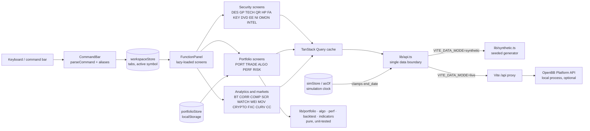

# Market Terminal

A keyboard-driven, terminal-style market workstation in the browser: 30 function screens, a point-in-time simulation clock, a paper portfolio with execution algorithms, and performance and risk analytics.

> **SHOWCASE VERSION** — This public repository is a sanitized demonstration of a private project. Proprietary logic, parameters, and licensed data have been removed or replaced with synthetic data. The full private repository can be reviewed on request: read-only collaborator access can be granted during an interview.

> **Synthetic data by default.** The demo runs fully offline. Every price, fundamental, headline and option chain is generated in the browser by a seeded random process (`app/src/lib/synthetic.ts`). Tickers in the demo universe (`ALFA`, `BRVO`, …) are fictional. Any other symbol you type gets a synthetic series under that label. **Nothing shown in synthetic mode is real market data.**

---

## Problem and motivation

Professional market terminals are expensive and closed. Free data is scattered across many APIs. This project explores how much of the terminal workflow can be built on free and open tooling. The goal is one command bar, many dense panels, and a strict separation between the UI and the data layer. It then adds features that are useful for learning:

- **Time travel.** Rewind the whole terminal to any past date and see what was knowable then.
- **Paper portfolio.** Trade inside that rewound world and measure performance and risk honestly. Look-ahead contamination is labelled, not hidden.

## Architecture



- **One data boundary.** Every panel goes through `get()` in `app/src/lib/api.ts`. The simulation clock (`lib/asOf.ts`) clamps historical requests there, so moving the clock moves every range-based panel with no per-panel code. The same boundary switches between the synthetic generator and live OpenBB.
- **Pure analytics.** Portfolio accounting, execution-algorithm slicing, performance statistics, backtests and indicators are side-effect-free modules in `app/src/lib/`, each with its own Vitest suite.
- **State.** Zustand stores (workspace, simulation, portfolios, watchlist, screener) persist to `localStorage`.

## Tech stack

| Layer | Tools |
|---|---|
| UI | React 18, TypeScript 5, Vite 5, Tailwind CSS 3 |
| State and data fetching | Zustand 5, TanStack Query 5 |
| Charts | TradingView lightweight-charts 4, hand-drawn SVG (yield curve, sparklines) |
| Tests and quality | Vitest, ESLint (typescript-eslint, react-hooks), `tsc -b` |
| Optional live backend | OpenBB Platform API (separate local process, AGPL-3.0, not bundled) |

## Key features

- **Command bar.** `[SYMBOL[,SYMBOL…]] CODE` with history (↑/↓), tab-completion and multi-tab workspaces. A bare ticker opens the `INTEL` scorecard.
- **Security screens:**
  - `DES` profile
  - `GP` candlestick chart with SMA/EMA/Bollinger overlays and RSI/MACD studies
  - `TECH` RSI/MACD/Bollinger/ATR/ADX/OBV
  - `QR` quote
  - `HP` price history
  - `FA` income statement
  - `KEY` ratios
  - `DVD` dividends
  - `EE` analyst targets
  - `NI` news
  - `OMON` options chain
- **`INTEL` scorecard.** Transparent rule-based reads across technicals, valuation, fundamentals, analysts and dividends (`app/src/lib/signals.ts`). The thresholds are textbook defaults.
- **Simulation clock (`PSIM`).** Set an as-of date, step it by day, week, month or year, or replay it. Panels with no point-in-time source show a `LOOKAHEAD` banner.
- **Paper portfolio:**
  - `PORT` holdings and P&L
  - `TRADE` blotter, filled at the as-of close
  - `ALGO` TWAP, VWAP, POV and Iceberg parent orders, one child fill per session
  - `PERF` equity curve vs. benchmark, with Sharpe, Sortino, Calmar and drawdown
  - `RISK` volatility, historical VaR, beta and concentration
- **Analytics:**
  - `BT` SMA-cross, RSI-band or MACD rule vs. buy-and-hold
  - `CORR` correlation matrix
  - `COMP` peer ratio comparison
  - `SCR` screener with signals, preset filters, custom min/max ranges and sector groups
- **Markets and macro:** `WATCH` watchlist, `WEI` world indices, `MOV` movers, `CRYPTO`, `FXC` FX, `CURV` yield curve and spreads, and the `CC` command-center dashboard.

## Run the demo (synthetic data, offline)

Requirements: Node.js 18 or newer.

```bash
cd app
npm ci
npm run dev        # http://localhost:5173, VITE_DATA_MODE=synthetic (from .env.development)
```

Try `CC`, `ALFA` (INTEL), `ALFA GP`, `ALFA,BRVO CORR`, `SCR`, `CURV`, then `PSIM` to rewind the clock, then `PORT` → `TRADE` → `ALGO` → `PERF` → `RISK`.

Quality gates:

```bash
cd app
npm test           # Vitest unit tests (fixed UTC-5 timezone for date assertions)
npm run typecheck
npm run lint
npm run build
```

### Live mode (optional, not needed for the demo)

Live mode proxies to a local [OpenBB Platform](https://github.com/OpenBB-finance/OpenBB) API on port 6900:

```bash
./setup.sh         # creates .venv, installs OpenBB, runs npm ci (Python 3.10–3.12)
./start.sh         # starts OpenBB + the UI with `npm run dev:live`
./stop.sh
```

Live data comes from third-party providers through OpenBB, such as Yahoo Finance, Finviz, the Federal Reserve and SEC. It is subject to their terms of service and is for personal, non-commercial use. `python/sitecustomize.py` patches OpenBB's screener provider for two input and output edge cases.

## Screenshots

> Placeholders. Images are intentionally not included yet. Capture them from the synthetic demo so no real market data appears.

| # | What to capture | Suggested file |
|---|---|---|
| 1 | `CC` command center, full window, with the status bar showing "SYNTHETIC DATA" | `docs/img/cc.png` |
| 2 | `ALFA GP` one-year chart with SMA50/SMA200 overlays and the RSI study | `docs/img/gp.png` |
| 3 | `PSIM` set to a past date, showing the amber simulation bar | `docs/img/psim.png` |
| 4 | `PORT` + `PERF` after a few `TRADE`s and one `ALGO` TWAP order | `docs/img/portfolio.png` |
| 5 | `SCR` with a signal and a custom min/max range | `docs/img/scr.png` |
| 6 | Short GIF: typing commands and switching tabs | `docs/img/demo.gif` |

## Project structure

```
market-terminal/
├── app/
│   ├── index.html
│   ├── .env.development / .env.production   # VITE_DATA_MODE=synthetic
│   ├── .env.live                            # VITE_DATA_MODE=live (npm run dev:live)
│   └── src/
│       ├── App.tsx, main.tsx
│       ├── components/      # CommandBar, QuickBar, WorkspaceTabs, StatusBar, FunctionPanel, screener/*
│       ├── functions/       # one file per function screen (30)
│       ├── hooks/           # shared data hooks (portfolio, candles)
│       ├── lib/
│       │   ├── api.ts           # single data boundary (synthetic | live)
│       │   ├── synthetic.ts     # seeded synthetic market generator
│       │   ├── dataMode.ts
│       │   ├── asOf.ts          # simulation clock
│       │   ├── portfolio.ts, algo.ts, perf.ts, backtest.ts, indicators.ts, signals.ts
│       │   └── screener/        # catalogue, query building, client-side range cuts
│       └── store/           # Zustand stores (workspace, sim, portfolio, watchlist, screener)
├── python/sitecustomize.py  # live mode only: OpenBB screener patch
├── setup.sh / start.sh / stop.sh   # live mode tooling
├── .github/workflows/ci.yml        # test · typecheck · lint · build
├── LICENSE
└── NOTICE                          # attribution and third-party notices
```

## Limitations

- **Synthetic data is random.** GBM price paths with plausible but arbitrary fundamentals. Do not read any market meaning into the demo numbers. Labels such as index or FX names in `CC`, `WEI` and `FXC` sit on top of synthetic series.
- **Screener in synthetic mode.** Signal sorting and custom min/max ranges work. Preset filter buckets are not evaluated against the synthetic universe.
- **Daily bars only.** Trades fill at the as-of close; algorithm child orders fill once per session; backtests fill at the next bar's open.
- **Backtests are optimistic.** No fees, slippage or spread, and the rule is chosen on the same history it is tested on.
- **Long only, price return only.** No shorting or margin, and no dividend reinvestment.
- **Polling, not streaming.** Panels refresh on 3–60 s intervals.
- **In live mode**, fundamentals, news, analyst data and options are not point-in-time. Panels using them show a `LOOKAHEAD` banner when the clock is rewound.

## Roadmap

- Evaluate preset screener filters against the synthetic universe.
- Transaction-cost and slippage model for `TRADE`, `ALGO` and `BT`.
- Dividend-adjusted total-return accounting.
- Intraday bars for execution algorithms.
- Export and import of portfolios (CSV).

## What this showcase omits and why

| Omitted / changed | Why |
|---|---|
| Original product name, page titles and one function code (renamed to `ALGO`) | They referenced a third-party trademark. The project is presented as an independent, terminal-style educational tool. |
| Third-party screener catalogue text | Replaced with a reduced catalogue and original descriptions. Option values are kept only as the parameter values the optional live provider accepts. |
| Live market data, caches and any downloaded datasets | Third-party data with redistribution restrictions. Replaced by the seeded synthetic generator. |
| Private installer script and internal research notes | Pointed at the private repository, or were internal working documents. |
| Git history | The showcase starts from a fresh history. |
| Google Fonts link | Replaced with a self-hosted font so the demo makes no third-party requests. |

Attribution: this project began from an earlier open terminal prototype. See [NOTICE](NOTICE) for the upstream credit and licensing status.

## License

All rights reserved. See [LICENSE](LICENSE) and [NOTICE](NOTICE).
